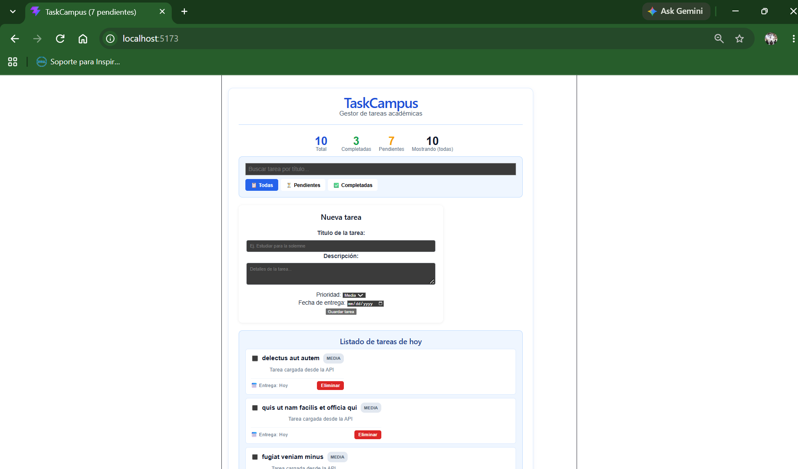
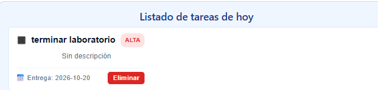
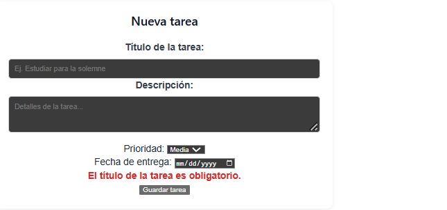
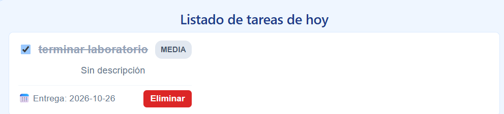
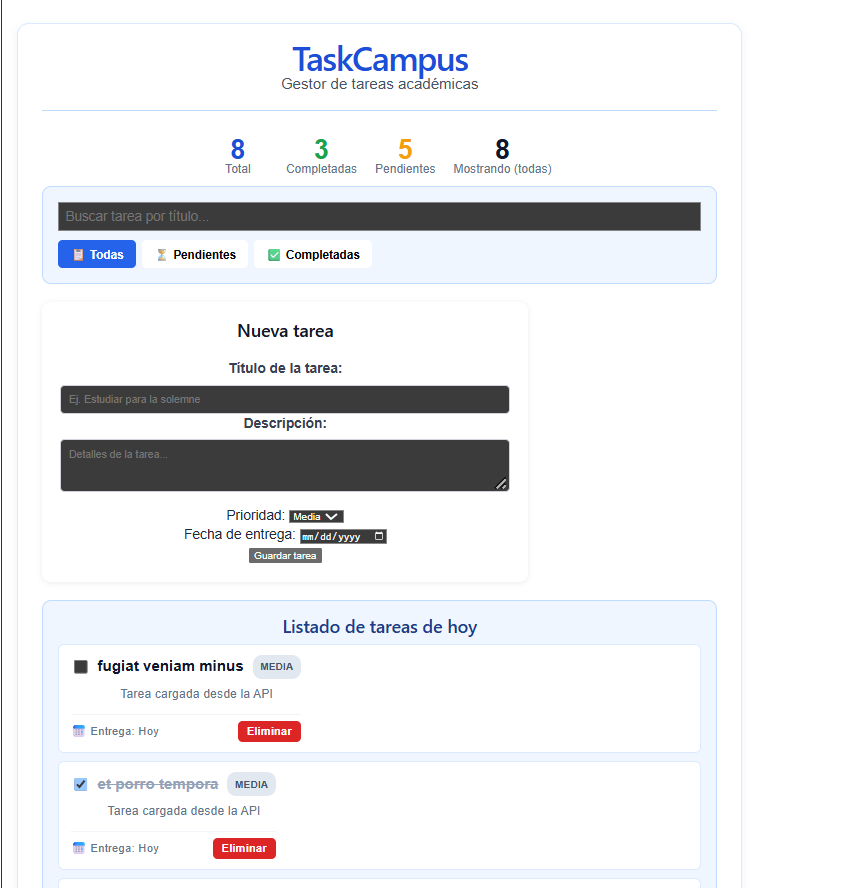
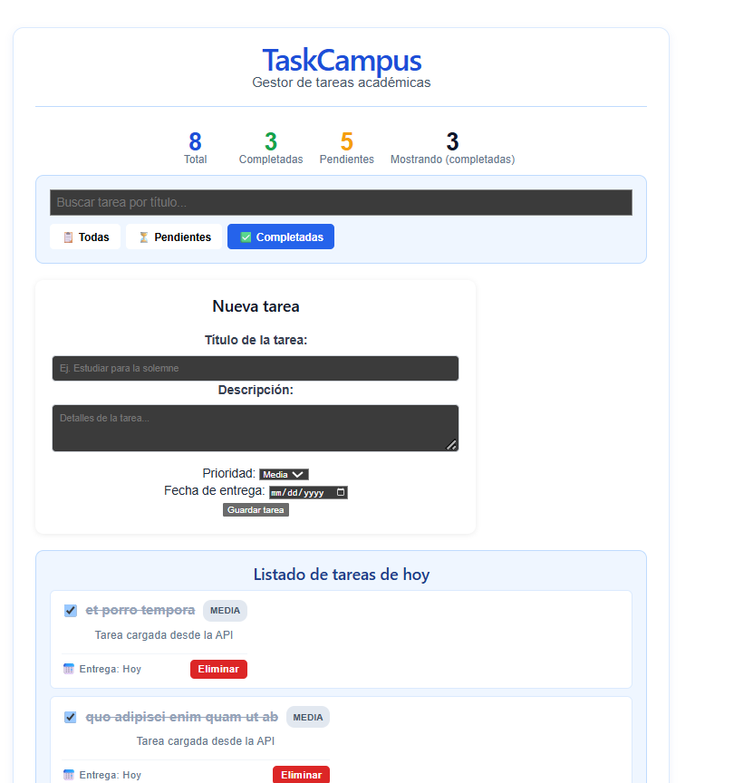
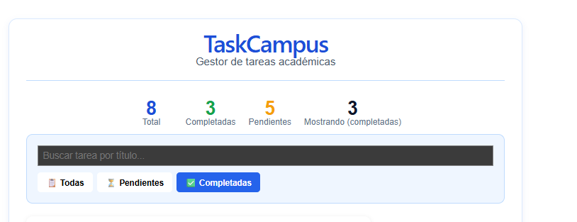

```markdown
# TaskCampus

Aplicación web para la gestión de tareas académicas desarrollada con React y Vite.

## Requisitos del Entorno
* Node.js: v20.x o superior
* npm: 10.x o superior

## Instalación, Ejecución y Compilación
1. Instalar las dependencias del proyecto:
   ```bash
   npm install

```

2. Iniciar el servidor de desarrollo local:
```bash
npm run dev

```


3. Compilar el proyecto para entorno de producción:
```bash
npm run build

```


## Comparación: Proyecto Base vs Desarrollo

El proyecto base constaba de una interfaz puramente estática con tres tareas fijadas estáticamente en el código fuente de los componentes y botones que únicamente lanzaban alertas nativas del navegador. El desarrollo implementado transformó esta base en una Single Page Application (SPA) dinámica, estructurada en vistas separadas, que gestiona su ciclo de vida mediante hooks de React, consume peticiones HTTP de una API externa, implementa operaciones de estado inmutables y sincroniza filtros y contadores calculados en tiempo real.

## Arquitectura y Limitaciones de la API

El sistema delega la lógica de negocio al hook `useTasks` y las peticiones asíncronas al módulo `tareasService.js`, logrando separar la capa de presentación de la capa de datos.

**Alcance de la persistencia:** La aplicación consume la API de pruebas pública `JSONPlaceholder`. Las operaciones de escritura (creación, edición y eliminación) se simulan exitosamente y actualizan el estado local durante la sesión activa del usuario. Sin embargo, dado el carácter simulado del servicio externo, los cambios no se consolidan de forma permanente en la base de datos del servidor. Al recargar el navegador, la aplicación recuperará nuevamente el estado remoto original.

## Registro de Investigación y Aplicación al Proyecto

### 1. Navegación entre vistas

* **Explicación conceptual:** La navegación simula un enrutador estructurando variables de estado que determinan qué bloque JSX debe montarse o desmontarse (renderizado condicional), logrando aislar lógicamente cada pantalla.
* **Fuentes consultadas:** Documentación oficial de React (Conditional Rendering).
* **Archivos aplicados:** `src/App.jsx`, `src/components/Navigation.jsx`
* **Procedimiento de verificación:** Hacer clic en los controles del menú superior de navegación. La interfaz cambia entre el "Resumen", la "Lista de Tareas" y el "Formulario de Creación" instantáneamente, sin ejecutar peticiones HTTP adicionales ni perder las modificaciones aplicadas al estado de la sesión.

### 2. Estado derivado

* **Explicación conceptual:** La información que es consecuencia lógica de los datos crudos (como las tareas pendientes o visibles tras un filtro) se calcula paramétricamente en tiempo de ejecución (mediante funciones como `filter` y `length`) para evitar la desincronización que ocurre al manejar variables de estado separadas.
* **Fuentes consultadas:** Documentación oficial de React (Choosing the State Structure / Derived State).
* **Archivos aplicados:** `src/hooks/useTasks.jsx`
* **Procedimiento de verificación:** Generar una nueva tarea y marcarla como completada. El panel de Resumen actualiza inmediatamente la suma matemática del total y las completadas de forma automática sin ejecutar despachos manuales de eventos para actualizar métricas numéricas.

### 3. Actualización funcional del estado

* **Explicación conceptual:** En entornos asíncronos y de múltiples mutaciones rápidas, se inyectó una función callback dentro del *setter* del estado (ej. `setTasks(prevTasks => ...)`). Esto asegura que React procese la actualización calculando las diferencias desde la última versión real en la cola del renderizado y no desde la variable del cierre léxico original.
* **Fuentes consultadas:** Documentación oficial de React (Queueing a Series of State Updates).
* **Archivos aplicados:** `src/hooks/useTasks.jsx`
* **Procedimiento de verificación:** Ejecutar peticiones concurrentes como eliminar múltiples tareas secuencialmente. La lógica inmutable usando `.filter` sobre `prevTasks` evita colisiones de punteros de memoria y caídas del render.

### 4. Identificadores y API simulada

* **Explicación conceptual:** JSONPlaceholder emite consistentemente identificadores idénticos (ej. `id: 201`) para cada nuevo objeto creado mediante POST, rompiendo la regla de renderizado de React de claves únicas. Para solucionarlo, se separó el `id` (identidad de renderizado local como UUID) del `remoteId` (identidad de la API usada para peticiones de red).
* **Fuentes consultadas:** JSONPlaceholder Guide, React Documentation (Rendering Lists / Keys).
* **Archivos aplicados:** `src/constants/initialTasks.js`, `src/hooks/useTasks.jsx`
* **Procedimiento de verificación:** Crear dos tareas consecutivas con el nombre "Prueba 1" y "Prueba 2". Ningún error de `Encountered two children with the same key` se registra en la consola del navegador.

## Tabla de Pruebas

## Tabla de Pruebas

| Caso probado | Pasos | Resultado esperado | Resultado obtenido | Evidencia asociada |
| --- | --- | --- | --- | --- |
| **Carga inicial HTTP (RF01)** | Iniciar entorno local sin datos cacheados | Descarga y renderizado de los 10 primeros registros en pantalla | 10 elementos renderizados correctamente |  |
| **Generación de entidad POST (RF03)** | Llenar formulario, presionar "Guardar" | Tarea inyectada en el arreglo local como "Pendiente" | Tarjeta insertada; notificación silenciosa en consola |  |
| **Validación de input estricta (RF04)** | Enviar campos de texto vacíos o con espacios | Despliegue de error, la transacción HTTP se aborta | Operación prevenida, advertencia visual ejecutada |  |
| **Conmutación de estado PATCH (RF05)** | Clic en la casilla de tarea | Cambio semántico a completado; se tacha el texto | Actualización inmutable efectiva en memoria |  |
| **Destrucción de entidad DELETE (RF07)** | Solicitar eliminación, aceptar modal de control | Tarjeta deshechada del DOM, contadores reducidos | Elemento purgado del DOM y de la memoria React |  |
| **Discriminación por filtros (RF08)** | Clicker el botón "Pendientes" | Renderizado estricto de elementos sin estado completado | Visibilidad reducida con precisión paramétrica |  |
| **Sincronización de cálculos (RF10)** | Modificar inventario de tareas actual | Vista "Resumen" debe oscilar de inmediato | Números atados directamente al bloque de memoria |  |